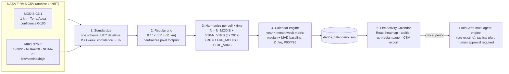

# FocoCerto Harmonizer

[](https://www.spaceappschallenge.org/)
[](docs/spaceapps/01-desafio/01-enunciado-e-detalhes.md)
[](#team)
[](LICENSE)
[](requirements.txt)

**NASA International Space Apps Challenge 2026** · Challenge: **Harmonization of MODIS and VIIRS Hot Spots**
Team **ECOMP - UFSM** (Universidade Federal de Santa Maria, Brazil)

> **FocoCerto Harmonizer turns 26 years of NASA FIRMS hot-spot detections, split between MODIS (1 km, 2000→) and
> VIIRS (375 m, 2012→), into one consistent time series, and shows it as an interactive Fire Activity Calendar that
> flags unusual and critical fire periods for a selected area.** A critical period can then be handed to FocoCerto's
> multi-agent engine to draft a tactical crew-dispatch plan for human review.

---

## Contents
1. [Quick start (30 seconds)](#quick-start-30-seconds)
2. [The problem](#the-problem)
3. [Architecture: how the harmonization works](#architecture-how-the-harmonization-works)
4. [Fire Activity Calendar](#fire-activity-calendar)
5. [Usage](#usage)
6. [Examples](#examples)
7. [Tests](#tests)
8. [Prior work (transparency statement)](#prior-work-transparency-statement)
9. [NASA data and acknowledgements](#nasa-data-and-acknowledgements)
10. [Limitations](#limitations)
11. [Team](#team) · [License](#license)

---

## Quick start (30 seconds)

Needs **Python 3.12** and **git**. No API keys, no network access during the run: sample mode reads only the files
in [`data/samples_firms/`](data/samples_firms/).

```bash
git clone https://github.com/ufsm-ecomp-genai/fococerto.spaceapps.git && cd fococerto.spaceapps
python3.12 -m venv .venv && source .venv/bin/activate && pip install -r requirements.txt   # once
python3 -m app.cli --sample --calendario
```

Expected output (abridged):
```text
Harmonização MODIS + VIIRS (grade 0.1°, beta VIIRS 0.3) [DADOS DE AMOSTRA]
  MODIS: 10 focos (modis_sample_c6.csv) | VIIRS: 21 focos (viirs_sample_375m.csv)
  9 registros célula x dia em 9 células; N_harm = 16.3 (vs 31 se somados brutos); FRP total = 670.9 MW
Fire Activity Calendar 2000-2026 (Tocantins / Cerrado) [AMOSTRA: climatologia SINTÉTICA + CSVs de amostra]
  CRITICO Aug 2024: ... (Z=4.39) Extreme thermal anomaly: +226% vs 25-year historical median
  JSON: web/app/src/assets/dados_calendario.json
```

**See the calendar in the browser** (the web app is prebuilt in `web/dist/`, so only Python is needed):
```bash
uvicorn app.api:app --port 8000      # open http://localhost:8000 → "Fire calendar" tab
```
Windows (PowerShell): `py -3.12 -m venv .venv`, then `.venv\Scripts\Activate.ps1`, then the same commands.

> **About the demo data.** The two sample CSVs are 31 FIRMS-format detections over two days (15–16 Sep 2024,
> Tocantins). To give the calendar 26 years to show offline, the demo adds a **deterministic synthetic climatology**
> (seed 2026). The JSON and the UI label this as `SAMPLE / SYNTHETIC`; it is not a NASA observation. Real analyses
> use FIRMS archive downloads (see [Usage](#usage)).

---

## The problem

NASA FIRMS has continuous active-fire records since November 2000 (MODIS Terra/Aqua, Collection 6.1) and since
January 2012 a second, sharper record (VIIRS 375 m on Suomi-NPP, NOAA-20 and NOAA-21). The two do not add up:

| | MODIS C6.1 | VIIRS 375 m |
|---|---|---|
| Pixel at nadir | ~1 km² | ~0.14 km² (≈ 7.1× smaller) |
| Record | Nov 2000 → present | Jan 2012 → present |
| Confidence | numeric 0–100 | `low` / `nominal` / `high` |
| Hot spots for the same fire | 1 | typically 3–4 |

Summing raw counts makes every year after 2012 look like a fire catastrophe; using only MODIS throws away the
better sensor; using only VIIRS loses the first 12 years. Fire managers need **one comparable series** to answer
*"is this month unusual for this place?"*

---

## Architecture: how the harmonization works



| Step | Code | What it does |
|---|---|---|
| Standardize | [`app/data/harmonizacao.py`](app/data/harmonizacao.py) `carregar_e_padronizar_focos` | Reads FIRMS CSVs; maps satellites (`T/A`, `N/1/2`), VIIRS confidence `low/nominal/high → 30/65/90 %`, UTC datetime, ISO week (1–52); de-duplicates; optional minimum confidence |
| Grid | `obter_celula_grade`, `agregar_em_grade` | Snaps each detection to the centre of its 0.1° cell |
| Harmonize | `harmonizar_series` | Per cell and day (or week/month): count equivalence and radiative-power conservation, below |
| Calendar | [`app/data/calendario.py`](app/data/calendario.py) `construir_matriz_temporal` | Year × period matrix 2000–2026, robust baseline, anomaly index, status per cell |
| Export | `exportar_calendario_json` | JSON contract in [`CONTEXT.md`](CONTEXT.md) §4, consumed by the web app |
| UI | [`web/app/src/FireCalendar.jsx`](web/app/src/FireCalendar.jsx) | Heatmap, tooltip, comparison panel, CSV download, tactical-plan button |

### The equations

For each 0.1° cell and time interval *t*:

$$\text{FRP}_{\text{harm}}(t) = \sum_{i \in \text{MODIS}} \text{FRP}_i + \sum_{j \in \text{VIIRS}} \text{FRP}_j$$

$$N_{\text{harm}}(t) = \begin{cases} N_{\text{MODIS}}(t), & t < 2012 \\ N_{\text{MODIS}}(t) + 0.30 \cdot N_{\text{VIIRS}}(t), & t \ge 2012 \end{cases}$$

Both are linear, so daily cell values can be summed into weeks or months without bias (tested). Calendar baseline
for period *p* (month 1–12 or ISO week 1–52), leaving the evaluated year out of its own baseline:

$$\tilde{\mu}_p = \operatorname{median}\{N_{\text{harm}}(y,p)\},\qquad \sigma_p \approx 1.4826 \cdot \text{MAD}_p,\qquad Z_{\text{fire}}(y,p) = \frac{N_{\text{harm}}(y,p) - \tilde{\mu}_p}{\sigma_p}$$

| Status | Rule |
|---|---|
| `NORMAL` | Z < 1.0 |
| `ATENCAO` (watch) | 1.0 ≤ Z < 2.0 |
| `CRITICO` (critical) | Z ≥ 2.0 **or** value above the baseline P95 |
| `SEM_DADOS` (no data) | period not yet observed |

The median/MAD pair is used instead of mean/standard deviation because fire seasons are heavy-tailed: one
catastrophic year would otherwise inflate the baseline and hide the next one. Scientific background (Giglio 2016,
Schroeder 2014, Wooster 2005, Sofiev 2020, ARSET): [`docs/spaceapps/04-fundamentacao-cientifica/`](docs/spaceapps/04-fundamentacao-cientifica/).

---

## Fire Activity Calendar

The **Fire calendar** tab of the web app (`web/app/src/FireCalendar.jsx`):

- **Heatmap:** rows are years (2026 on top, 2000 at the bottom), columns are months or ISO weeks (toggle).
  Intensity uses the colour-blind-safe ColorBrewer YlOrRd ramp (light yellow → dark red, log scale); `CRITICO`
  cells are magenta; `ATENCAO` cells get a purple ring; unobserved periods are hatched.
- **Tooltip** on hover or keyboard focus: period, harmonized hot spots, FRP, status and Z.
- **Click a cell:** side panel with "+X % above the historical median", Z, P90/P95, raw MODIS and VIIRS counts, FRP,
  and a bar chart of the same period across all years with the median line.
- **"Generate Tactical Response Plan (FocoCerto AI)"**: enabled for critical periods; opens the pre-existing
  multi-agent planner with the period selected.
- **Download CSV** of the matrix on screen. English and Portuguese, light and dark themes.

Build it yourself: `cd web/app && npm ci && npm run build` (output in `web/dist/`).

---

## Usage

```bash
# Harmonize + build the calendar from the sample CSVs (writes web/app/src/assets/dados_calendario.json)
python -m app.cli --sample --calendario

# Harmonization only: writes out/harmonizacao/focos_harmonizados.csv (one row per cell x day)
python -m app.cli --sample --harmonizar

# Your own FIRMS archive downloads (https://firms.modaps.eosdis.nasa.gov/download/), no synthetic data involved
python -m app.cli calendario --modis fire_archive_M-C61_XXXX.csv --viirs fire_archive_SV-C2_XXXX.csv \
    --ano-inicio 2000 --ano-fim 2026 --json out/calendario.json

# Pre-existing operational engine: plan one period for a scenario in cenarios/ (offline agents)
python -m app.cli --sample --cenario tocantins-escasso
```

From Python:
```python
from pathlib import Path
from app.data.harmonizacao import carregar_e_padronizar_focos, harmonizar_series
from app.data.calendario import construir_matriz_temporal, exportar_calendario_json

modis = carregar_e_padronizar_focos(Path("data/samples_firms/modis_sample_c6.csv"), "MODIS")
viirs = carregar_e_padronizar_focos(Path("data/samples_firms/viirs_sample_375m.csv"), "VIIRS", confianca_minima=30)
harm = harmonizar_series(modis, viirs)                 # list of {celula_id, data, n_modis, n_viirs, focos_harmonizados, frp_total_mw, ...}
cal = construir_matriz_temporal(harm, periodo="mes")   # or periodo="semana"
exportar_calendario_json(cal, Path("out/calendario.json"))
```

### Setup and dependencies
Python 3.12 and the packages pinned in [`requirements.txt`](requirements.txt). Node 24 only if you want to rebuild
the web app. Docker alternative: `docker compose -f web/compose.yaml up -d --build`. The real (non-sample) mode of
the pre-existing dispatch engine needs extra services; see [`docs/prior-work/operational-engine.md`](docs/prior-work/operational-engine.md).

---

## Examples

**Footprint reconciliation on the sample** (`data/samples_firms/`, 15–16 Sep 2024, Tocantins): the same fires are
seen as 10 MODIS and 21 VIIRS detections.

| Cell (0.1°) | Day | MODIS | VIIRS | Raw sum | **N_harm** | FRP (MW) |
|---|---|---|---|---|---|---|
| −10.2, −48.3 | 2024-09-15 | 3 | 7 | 10 | **5.1** | 185.7 |
| −10.5, −48.9 | 2024-09-15 | 1 | 2 | 3 | **1.6** | 141.8 |
| −12.1, −48.6 | 2024-09-16 | 1 | 2 | 3 | **1.6** | 120.5 |
| … 6 more cells | | | | | | |
| **Total (9 cells)** | | **10** | **21** | **31** | **16.3** | **670.9** |

The raw sum would report 31 "fires"; the harmonized series reports 16.3 MODIS-equivalent detections while keeping
all 670.9 MW of radiative power. Reproduce with `python -m app.data.harmonizacao`.

Other examples: pre-existing dispatch plans in [`output_examples/`](output_examples/) and scenarios in
[`cenarios/`](cenarios/).

---

## Tests

```bash
python -m pytest tests/test_harmonizacao.py -v   # 27 tests: CSV parsing, confidence mapping, grid, count equivalence,
                                                 # FRP conservation, anomaly detection, JSON contract, CLI
python -m pytest -q                              # whole suite: 352 passed, 7 skipped (15 Nov 2026), ~20 s, offline
cd web/app && npm test && npm run build          # web unit tests and production build
```
No test needs an API key or internet access.

---

## Prior work (transparency statement)

NASA Space Apps allows pre-existing work if it is declared. This repository started from the team's earlier
**FocoCerto** project (built in October 2026 for a previous hackathon); the Space Apps repository was created on
15 Nov 2026 from that base.

| | What | Where |
|---|---|---|
| **Pre-existing work** | Multi-agent operational reasoning engine (Planner ⇄ Critic ⇄ Analyst loop with deterministic tools, rules and citation checks), region configs and dispatch scenarios, plan/map outputs, HTTP API, and the base web interface (map, resources, history, help) | `app/agents/`, `app/tools/`, `app/core/`, `app/llm/`, `app/output/`, `app/api.py`, `services/`, `eval/`, most of `web/app/src/`; original README: [`docs/prior-work/operational-engine.md`](docs/prior-work/operational-engine.md) |
| **New work during Space Apps** | MODIS (1 km) vs VIIRS (375 m) footprint harmonization on a 0.1° grid; count equivalence and FRP conservation; 26-year (2000–2026) time-series engine with median/MAD baseline, Z_fire, P90/P95 and status; the Fire Activity Calendar web component; the `calendario` / `--calendario` / `--harmonizar` CLI; FIRMS sample datasets, scientific dossier and tests | `app/data/harmonizacao.py`, `app/data/calendario.py`, `web/app/src/FireCalendar.jsx`, `web/app/src/fireCalendar.css`, `tests/test_harmonizacao.py`, `data/samples_firms/`, `docs/spaceapps/`, `CONTEXT.md` |

The exact boundary is in the git history. AI tools: code, tests and documentation were written with the help of
**Claude Code (Anthropic)**; the team reviewed and tested the result and is responsible for it.

---

## NASA data and acknowledgements

- **NASA FIRMS** — Fire Information for Resource Management System, <https://firms.modaps.eosdis.nasa.gov/>.
  - MODIS Collection 6.1 active fire product (MCD14DL / MOD14 / MYD14), Terra and Aqua. Giglio, L., Schroeder, W.,
    Justice, C. O. (2016). *The collection 6 MODIS active fire detection algorithm and fire products.* Remote
    Sensing of Environment, 178, 31–41.
  - VIIRS 375 m active fire product (VNP14IMGTDL, VJ114IMGTDL, VJ214IMGTDL), Suomi-NPP, NOAA-20, NOAA-21.
    Schroeder, W., Oliva, P., Giglio, L., Csiszar, I. A. (2014). *The New VIIRS 375 m active fire detection data
    product.* Remote Sensing of Environment, 143, 85–96.
  - *We acknowledge the use of data and imagery from LANCE FIRMS operated by NASA's Earth Science Data and
    Information System (ESDIS) with funding provided by NASA Headquarters.*
- **CONAE** (Comisión Nacional de Actividades Espaciales, Argentina), partner space agency of this challenge, whose
  operational use of FIRMS for fire emergencies in South America inspired the "critical period → response plan" flow.
- Scientific dossier and challenge material: [`docs/spaceapps/`](docs/spaceapps/README.md).

NASA does not endorse this project. Use of NASA names follows
[`docs/spaceapps/02-regras-e-diretrizes/04-diretrizes-marca-nasa.md`](docs/spaceapps/02-regras-e-diretrizes/04-diretrizes-marca-nasa.md).

---

## Limitations

- **Demo calendar is synthetic.** Offline, the 26-year matrix is a seeded synthetic climatology plus 31 sample
  detections; it demonstrates the method, not the real fire history of Tocantins. Run `calendario --modis --viirs`
  on FIRMS archive files for real results.
- **β = 0.30 is a fixed, region-agnostic coefficient.** With VIIRS seeing ~3.3× more hot spots, `N_MODIS + 0.30·N_VIIRS`
  is roughly 2× `N_MODIS`, so the post-2012 part of the series sits on a higher level than 2000–2011. A per-region
  β fitted on the 2012+ overlap (e.g. so that `N_harm ≈ N_MODIS` on average) would remove that step; this is the
  first planned improvement.
- **FRP is summed across sensors** as specified, so a fire seen by both sensors on the same day contributes the
  FRP of both observations; it is a radiative *activity* index, not an energy estimate of a single overpass.
- **A detection is not a fire:** clouds hide fires, the same fire is detected several times, and agricultural or
  industrial burning is included.
- **The 0.1° grid** is a compromise: coarser grids hide local events, finer grids reintroduce the footprint effect.
- ISO week 53 is folded into week 52 so every year has 52 columns.

---

## Team

**ECOMP - UFSM**, Computer Engineering, Universidade Federal de Santa Maria (Brazil). Roles and playbooks:
[`docs/spaceapps/03-papeis-equipe/`](docs/spaceapps/03-papeis-equipe/).

Repository: <https://github.com/ufsm-ecomp-genai/fococerto.spaceapps> · Task boards: [`tasks/`](tasks/README.md)

## License

[Apache License 2.0](LICENSE). Third-party components and their licenses are listed in
[`docs/prior-work/operational-engine.md`](docs/prior-work/operational-engine.md#credits-and-third-party-components).
