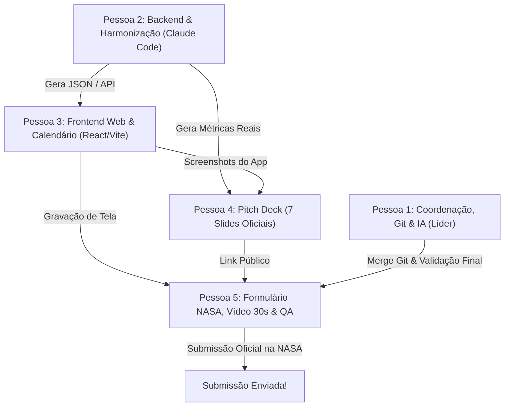

# Plano Mestre de Execução: Equipe ECOMP - UFSM (5 Pessoas)
## NASA International Space Apps Challenge 2026 — Desafio Harmonização MODIS e VIIRS

> [!IMPORTANT]
> **Prazo Final da Submissão:** Domingo, 15 de novembro às **23:59 (horário local)**.
> **Horário Atual:** Início da noite. Temos uma janela de sprint concentrada e de alto rendimento.
> **Objetivo:** Submissão completa, elegante, dentro de todas as regras da NASA e com código funcionando.

---

### 1. A Divisão de Papéis da Equipe (5 Integrantes)

| Integrante | Papel Principal | Ferramenta / Foco | Documento de Trabalho |
|---|---|---|---|
| **Pessoa 1 (Você)** | **Líder, Integração & Core AI** | Antigravity / Git / Arquitetura do FocoCerto | [`PAPEL-1-COORDENACAO-E-INTEGRACAO.md`](file:///home/dorneles/ecomp-ufsm-genai/fococerto-spaceapps/docs/spaceapps/PAPEL-1-COORDENACAO-E-INTEGRACAO.md) |
| **Pessoa 2 (Amigo)** | **Backend & Algoritmo de Harmonização** | Claude Code no terminal dele / Python | [`PAPEL-2-CLAUDE-CODE-HARMONIZACAO.md`](file:///home/dorneles/ecomp-ufsm-genai/fococerto-spaceapps/docs/spaceapps/PAPEL-2-CLAUDE-CODE-HARMONIZACAO.md) |
| **Pessoa 3** | **Frontend Web & UI do Calendário** | React / Vite / Tailwind / Leaflet (`web/`) | [`PAPEL-3-FRONTEND-CALENDARIO-WEB.md`](file:///home/dorneles/ecomp-ufsm-genai/fococerto-spaceapps/docs/spaceapps/PAPEL-3-FRONTEND-CALENDARIO-WEB.md) |
| **Pessoa 4** | **Design & Apresentação (7 Slides)** | Google Slides / Canva / Figma | [`PAPEL-4-DESIGN-E-SLIDES-7PAGINAS.md`](file:///home/dorneles/ecomp-ufsm-genai/fococerto-spaceapps/docs/spaceapps/PAPEL-4-DESIGN-E-SLIDES-7PAGINAS.md) |
| **Pessoa 5** | **Preenchimento do Portal, Vídeo 30s & QA** | Plataforma NASA Space Apps / Edição de Vídeo | [`PAPEL-5-SUBMISSAO-VIDEO-E-FORMULARIO.md`](file:///home/dorneles/ecomp-ufsm-genai/fococerto-spaceapps/docs/spaceapps/PAPEL-5-SUBMISSAO-VIDEO-E-FORMULARIO.md) |

---

### 2. Cronograma de Sprint em 4 Fases

#### Fase 1: Setup e Disparo em Paralelo (Primeiras 1h30m)
* **Pessoa 1:** Configura o ambiente, alinha os papéis com a equipe e distribui os documentos de trabalho.
* **Pessoa 2:** Abre o **Claude Code** com o documento `PAPEL-2` e implementa a harmonização matemática entre os feeds MODIS e VIIRS usando as amostras locais de `data/samples_firms/`.
* **Pessoa 3:** Inicia a tela de *Fire Activity Calendar* em `web/app/src/`, criando a estrutura da matriz (linhas: anos 2000–2026; colunas: semanas/meses).
* **Pessoa 4:** Abre o Google Slides/Canva com o template de 7 slides baseado em `PAPEL-4`.
* **Pessoa 5:** Entra na página da equipe no site da NASA, preenche as informações cadastrais dos membros e cria o rascunho da submissão com os textos prontos de `PAPEL-5`.

#### Fase 2: Integração e Geração de Ativos (Segunda 1h30m)
* **Pessoa 2:** Finaliza `app/data/harmonizacao.py` e `app/data/calendario.py`, gerando a saída JSON do calendário para a região de teste.
* **Pessoa 3:** Conecta o componente visual com o JSON gerado pela Pessoa 2, exibindo o heatmap com cores acessíveis (amarelo-laranja-vermelho) e alertas de períodos críticos.
* **Pessoa 4:** Recebe os screenshots reais do web app e os gráficos de validação para colocar nos slides 4 e 5.
* **Pessoa 5:** Grava a tela do app funcionando (ou os slides) para montar o vídeo de 30 segundos (ou valida os slides com a Pessoa 4).

#### Fase 3: Validação Cruzada & Revisão de Regras (Últimas 1h)
* **Pessoa 1:** Revisa o repositório, roda a suíte de testes com `--sample` e garante que a licença Apache-2.0 está ativa.
* **Pessoa 4 & 5:** Geram o link público do Google Drive / YouTube com permissão "Qualquer pessoa com o link pode ver" e testam em aba anônima.
* **Equipe Toda:** Faz a checagem do checklist oficial em `PAPEL-5`.

#### Fase 4: Submissão e Encerramento (30 minutos antes do prazo - até 23:30)
* **Pessoa 5 & Líder:** Colam todos os textos finais em inglês no portal da NASA.
* Clicam no botão **"Submit for Judging"**.
* Verificam o banner verde de confirmação e baixam os certificados de participação!
