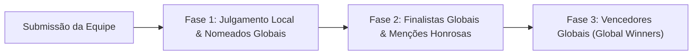

# Guia Oficial de Avaliação e Rubricas de Julgamento
## NASA International Space Apps Challenge 2026

Este documento reúne os critérios formais de pontuação, rubricas de avaliação e diretrizes que os comitês de jurados da NASA utilizam para avaliar projetos no nível Local e Global.

---

### 1. Fases de Julgamento

1. **Fase 1 (Local Event & Universal Event):** Os jurados avaliam todos os projetos elegíveis e selecionam até 2 *Global Nominees* por evento local.
2. **Fase 2 (NASA Executive Committee):** Especialistas e cientistas da NASA revisam todos os indicados globais e selecionam os *Global Finalists*.
3. **Fase 3 (Global Winners):** Comitê executivo da NASA seleciona os 10 vencedores globais em categorias como Melhor Uso de Dados, Melhor Uso de Tecnologia, Maior Impacto e Criatividade.

---

### 2. Os 5 Critérios Oficiais de Avaliação (Judging Criteria)

Os jurados avaliam cada projeto atribuindo notas de 1 a 5 em cinco eixos estruturantes:

| Critério | Peso | O que os Jurados Avaliam |
|---|---|---|
| **Impacto (Impact)** | 20% | Qual o potencial de impacto da solução na sociedade, ciência ou meio ambiente? A solução resolve um problema real de forma sustentável e escalável? |
| **Criatividade (Creativity)** | 20% | Quão inovadora é a abordagem? A solução propõe uma perspectiva original ou combina dados de maneiras inéditas para responder ao desafio? |
| **Validade e Rigor (Validity)** | 20% | A solução é cientificamente consistente e tecnicamente viável? Os cálculos, modelos matemáticos e integrações de dados são fundamentados e corretos? |
| **Relevância (Relevance)** | 20% | O projeto responde diretamente aos requisitos e objetivos do desafio específico da NASA? Demonstra aderência ao enunciado? |
| **Apresentação (Presentation)** | 20% | A comunicação é clara, concisa e atraente? Os slides ou vídeo transmitem o valor, a arquitetura e a demonstração com excelência dentro dos limites de 7 slides ou 30s? |

---

### 3. As 10 Categorias de Premiação Global

* **Best Use of Data:** Solução que melhor utiliza e integra os dados abertos de observação da Terra da NASA.
* **Best Use of Technology:** Solução com a arquitetura tecnológica, código e engenharia mais inovadores.
* **Galactic Impact:** Solução com maior potencial de impacto positivo no planeta ou na humanidade.
* **Best Mission Concept:** Conceito de missão mais promissor e bem formulado.
* **Most Inspirational:** Projeto mais inspirador e engajador.
* **Best Storytelling:** Projeto que melhor comunica e conta a história da solução.
* **Global Connection:** Solução com forte cooperação internacional e conexão entre comunidades.
* **Art & Technology:** Melhor combinação de arte, design e tecnologia.
* **Local Impact:** Maior potencial de impacto na comunidade local e regional.
* **Smallest Footprint:** Solução com maior eficiência de recursos e sustentabilidade.

---

### 4. Requisitos de Conformidade Legal e Originalidade
* **Open Source:** O código-base deve estar licenciado sob uma licença aberta compatível com OSI (como Apache 2.0).
* **Transparência de IA:** O uso de ferramentas de inteligência artificial generativa deve ser expressamente declarado e documentado no repositório e formulário.
* **Trabalho Prévio (Prior Work):** Qualquer código herdado de projetos anteriores deve ser demarcado formalmente para demonstrar o que foi construído durante a janela do hackathon.
