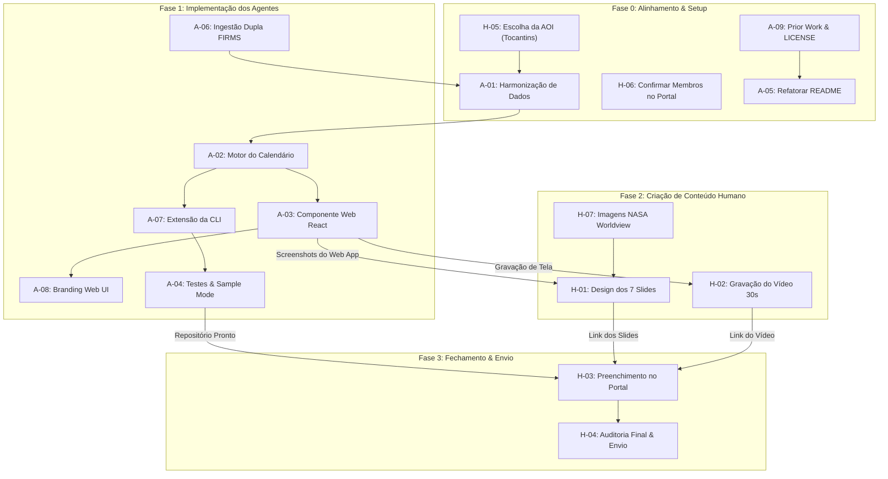

# Painel Geral de Tarefas: Trilha de Agentes x Trilha Humana
## NASA Space Apps Challenge 2026 — FocoCerto Harmonizer

Este diretório organiza todo o trabalho do projeto dividindo a execução entre tarefas executáveis por **Agentes de IA** (código, dados, testes, documentação técnica) e tarefas de **Execução Humana** (estratégia, design, gravação, validação e submissão).

---

### 1. Visão Geral das Duas Trilhas

| Trilha | Foco | Quem Executa | Pasta | Total de Tarefas |
|---|---|---|---|---|
| **Trilha dos Agentes** | Algoritmos, refatorações, scripts, APIs, componentes React e testes | Antigravity / Claude Code | [`agentes/`](agentes/) | **9 Tarefas** |
| **Trilha Humana** | Decisões de AOI, design gráfico, locução, vídeo, cadastro e QA | Membros da Equipe | [`humanas/`](humanas/) | **7 Tarefas** |

---

### 2. Fluxo Integrado de Dependências

---

### 3. Catálogo Completo das Tarefas

#### Trilha dos Agentes (`tasks/agentes/`)
1. [`task-agente-01-harmonizacao-dados.md`](agentes/task-agente-01-harmonizacao-dados.md): Módulo `app/data/harmonizacao.py` (agregação espacial de 0.1° e calibração de FRP MODIS + VIIRS).
2. [`task-agente-02-motor-calendario.md`](agentes/task-agente-02-motor-calendario.md): Módulo `app/data/calendario.py` (série histórica, linha de base e detecção de anomalias $Z_{\text{fire}}$).
3. [`task-agente-03-componente-web-react.md`](agentes/task-agente-03-componente-web-react.md): Componente `FireCalendar.jsx` em `web/app/src/` (matriz anual x semanal com cores acessíveis).
4. [`task-agente-04-testes-e-integracao.md`](agentes/task-agente-04-testes-e-integracao.md): Suíte de testes automatizados com `pytest` e validação com os dados de `data/samples_firms/`.
5. [`task-agente-05-refatoracao-readme-principal.md`](agentes/task-agente-05-refatoracao-readme-principal.md): Transformação do `README.md` raiz para a vitrine oficial do NASA Space Apps 2026.
6. [`task-agente-06-scripts-ingestao-dupla-firms.md`](agentes/task-agente-06-scripts-ingestao-dupla-firms.md): Atualização de `scripts/ingest_firms.py` para baixar múltiplos sensores simultaneamente.
7. [`task-agente-07-cli-extensao-calendario.md`](agentes/task-agente-07-cli-extensao-calendario.md): Adição das flags `--calendario` e `--harmonizar` na interface de linha de comando (`app/cli.py`).
8. [`task-agente-08-sanitizacao-branding-web.md`](agentes/task-agente-08-sanitizacao-branding-web.md): Atualização do `<title>`, navegação e créditos do NASA FIRMS no frontend web.
9. [`task-agente-09-declaracao-prior-work-e-licenca.md`](agentes/task-agente-09-declaracao-prior-work-e-licenca.md): Criação do documento formal de transparência de trabalho prévio e licença Apache 2.0.

#### Trilha Humana (`tasks/humanas/`)
1. [`task-humana-01-design-e-slides-7p.md`](humanas/task-humana-01-design-e-slides-7p.md): Criação visual no Canva / Google Slides respeitando o teto rígido de 7 lâminas.
2. [`task-humana-02-gravacao-video-30s.md`](humanas/task-humana-02-gravacao-video-30s.md): Gravação de voz com o roteiro em inglês, captura de tela do app e upload público.
3. [`task-humana-03-preenchimento-portal.md`](humanas/task-humana-03-preenchimento-portal.md): Cadastro da equipe (2 a 6 membros) e preenchimento de todos os campos em inglês.
4. [`task-humana-04-auditoria-qa-links.md`](humanas/task-humana-04-auditoria-qa-links.md): Teste de links públicos em janela anônima, verificação de conformidade e envio oficial até 23:30.
5. [`task-humana-05-definicao-aoi-demonstracao.md`](humanas/task-humana-05-definicao-aoi-demonstracao.md): Decisão da Área de Interesse principal da demonstração (Tocantins / Cerrado).
6. [`task-humana-06-confirmacao-membros-time.md`](humanas/task-humana-06-confirmacao-membros-time.md): Confirmação de que todos os colegas aceitaram o convite no portal oficial da NASA.
7. [`task-humana-07-coleta-imagens-nasa-worldview.md`](humanas/task-humana-07-coleta-imagens-nasa-worldview.md): Captura de imagens reais no NASA Worldview ilustrando a quebra MODIS vs VIIRS para os slides.
