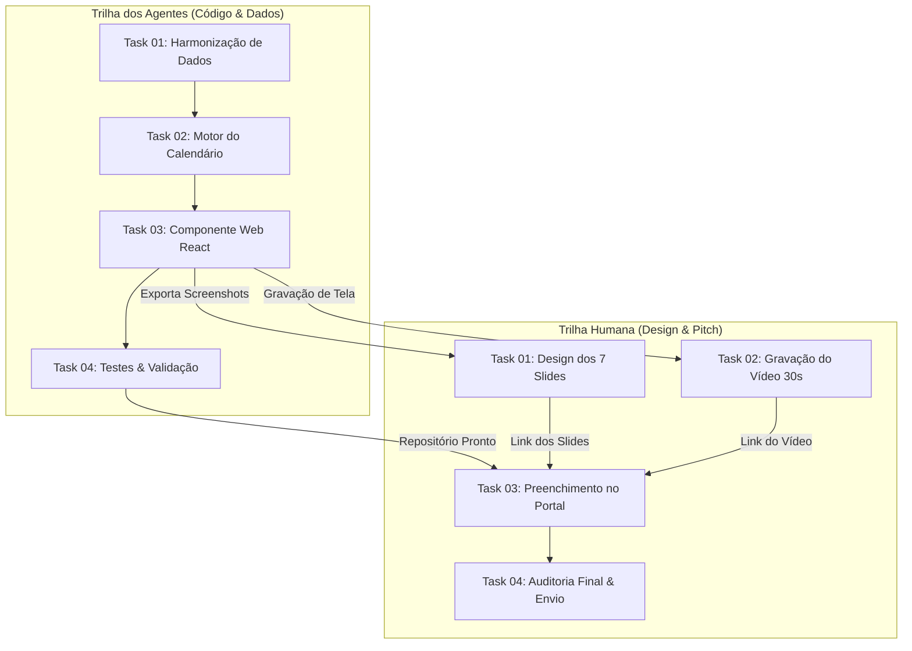

# Painel de Tarefas: Trilha de Agentes x Trilha Humana
## NASA Space Apps Challenge 2026 — FocoCerto Harmonizer

Este diretório organiza o trabalho do projeto dividindo a execução entre o que é **autônomo para Agentes de IA** (código, dados, testes) e o que exige **ação e criatividade Humana** (design, voz, vídeo, submissão).

---

### 1. Visão Geral das Duas Trilhas

| Trilha | Foco | Quem Executa | Pasta |
|---|---|---|---|
| **Trilha dos Agentes** | Algoritmos, modelos matemáticos, APIs, componentes React e testes | Antigravity / Claude Code | [`agentes/`](agentes/) |
| **Trilha Humana** | Design gráfico, locução, edição de vídeo, cadastro no portal e envio | Membros da Equipe | [`humanas/`](humanas/) |

---

### 2. Fluxo de Entregas e Dependências

---

### 3. Índice das Tarefas

#### Trilha dos Agentes (`tasks/agentes/`)
* [`task-agente-01-harmonizacao-dados.md`](agentes/task-agente-01-harmonizacao-dados.md): Módulo `app/data/harmonizacao.py` (agregação espacial de 0.1° e calibração de FRP MODIS + VIIRS).
* [`task-agente-02-motor-calendario.md`](agentes/task-agente-02-motor-calendario.md): Módulo `app/data/calendario.py` (série histórica, linha de base e detecção de anomalias $Z_{\text{fire}}$).
* [`task-agente-03-componente-web-react.md`](agentes/task-agente-03-componente-web-react.md): Componente `FireCalendar.jsx` em `web/app/src/` (matriz anual x semanal com cores acessíveis).
* [`task-agente-04-testes-e-integracao.md`](agentes/task-agente-04-testes-e-integracao.md): Suíte de testes automatizados com `pytest` e validação com os dados de `data/samples_firms/`.

#### Trilha Humana (`tasks/humanas/`)
* [`task-humana-01-design-e-slides-7p.md`](humanas/task-humana-01-design-e-slides-7p.md): Criação visual no Canva / Google Slides respeitando o teto rígido de 7 lâminas.
* [`task-humana-02-gravacao-video-30s.md`](humanas/task-humana-02-gravacao-video-30s.md): Gravação de voz com o roteiro em inglês, captura de tela do app e upload público.
* [`task-humana-03-preenchimento-portal.md`](humanas/task-humana-03-preenchimento-portal.md): Cadastro da equipe (2 a 6 membros) e preenchimento de todos os campos em inglês.
* [`task-humana-04-auditoria-qa-links.md`](humanas/task-humana-04-auditoria-qa-links.md): Teste de links públicos em janela anônima, verificação de conformidade e envio oficial.
